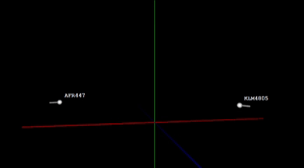

# TCAS Simulator

A real-time 3D aircraft conflict detection and resolution simulator written in Java.

It models aircraft motion in three-dimensional airspace, predicts loss-of-separation events using closest-point-of-approach (CPA) analysis, and applies simplified TCAS-inspired Traffic Advisories (TA) and Resolution Advisories (RA). The simulation is visualized in real time using JavaFX.

## Demo



- **White**: normal flight
- **Yellow**: Traffic Advisory (TA)
- **Red**: Resolution Advisory (RA)
- **CLIMB / DESCEND**: active vertical resolution command

## Collision Prediction

For two aircraft, the simulator calculates relative position and velocity:

```
r = positionB - positionA
v = velocityB - velocityA
```

The time to CPA, the relative position at CPA, and the minimum predicted separation are:

```
tCPA = -(r · v) / (v · v)
rCPA = r + v * tCPA
dCPA = |rCPA|
```

If `dCPA` falls below the configured minimum distance, the encounter is treated as a potential conflict.

## TCAS Logic

A predicted conflict progresses through three states:

```
NORMAL → TRAFFIC ADVISORY → RESOLUTION ADVISORY
```

A Resolution Advisory assigns coordinated, opposing vertical commands (e.g. Aircraft A: CLIMB, Aircraft B: DESCEND), which stay active until the encounter has passed and separation is restored.

| Advisory | Trigger |
|----------|---------|
| TA       | 60s |
| RA       | 20s |

This is a simplified educational simulation and is **not an implementation of certified TCAS II logic**.

## Architecture

Simulation logic is separated from visualization.

- **Simulation**: `Aircraft` holds physical state, `Simulation` advances the world and evaluates encounters (alongside `Airspace`, `Vector3`, `AircraftPair`, `EncounterResult`)
- **Collision detection**: `CollisionDetector` performs the relative-motion and CPA calculations
- **TCAS**: `TCAS` turns predictions into advisory states and vertical resolution commands
- **Visualization**: `App` runs the real-time loop, and `AircraftView` renders aircraft and trajectory trails with JavaFX

## Testing

Automated JUnit tests cover:

- Head-on, crossing, diverging, equal-velocity, and near-miss encounters
- Existing loss of separation
- TA and RA thresholds
- Coordinated climb / descend selection
- End-to-end simulation behavior

```
./gradlew test
```

## Running

Requires Java 25, Gradle, and JavaFX.

```
./gradlew run --no-configuration-cache
```